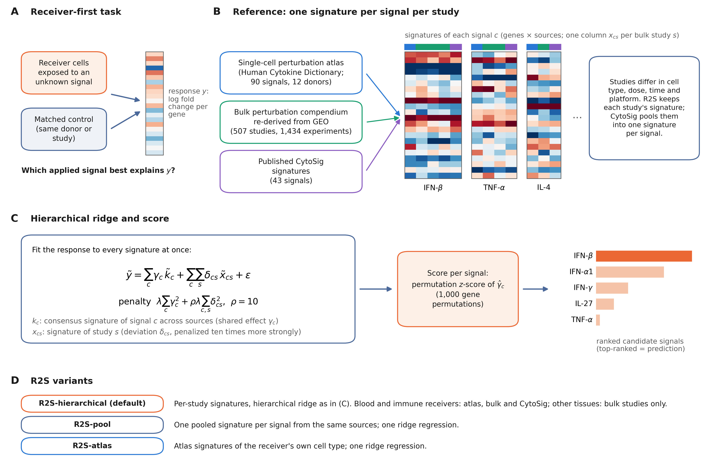

# Response2Signal (R2S)

**Which extracellular signal does a cell population's transcriptional response point to?**
Response2Signal (R2S) answers this receiver-first question. Given the response of a receiver population to an
unknown signal, measured against a matched control, R2S ranks candidate signals by how well their reference
perturbation responses explain it.

Its reference keeps **one signature per signal per study**, drawn from three sources:

- a single-cell cytokine perturbation atlas (the Human Cytokine Dictionary; 90 cytokines, five blood cell types);
- a compendium of 1,434 public bulk perturbation experiments from 507 GEO studies, re-derived from the deposited
  data;
- the published CytoSig signatures.

Studies of the same signal differ in cell type, dose, time and platform, so instead of pooling them into one
signature R2S combines them in a **hierarchical ridge regression**: each study contributes a shared signal effect
plus a penalized study-specific deviation.

This repository accompanies the manuscript *Response2Signal: integrating single-cell and bulk perturbation studies
to identify extracellular signals from receiver responses* (under review).



*(A) The input is the response of receiver cells to an unknown signal, relative to a matched control. (B) The
reference keeps one signature per signal per study. (C) A hierarchical ridge fits all signatures at once; the score
of a signal is the permutation z-score of its shared coefficient. (D) The three R2S variants.*

## Contents

| Path | Contents |
|---|---|
| `src/response2signal/` | the R2S Python package |
| `data/r2s_signatures_v1/` | the R2S signature database |
| `examples/` | a minimal runnable example with bundled data |
| `tests/` | unit tests |
| `paper/` | scripts and source tables that reproduce the figures and tables of the main text |

## Installation

R2S needs Python 3.10 or later; the package itself depends only on numpy, scipy and pandas.

```bash
git clone https://github.com/katherinewxie/response2signal.git
cd response2signal
pip install -e .                 # R2S
pip install -e ".[anndata]"      # optional: build responses from an AnnData object
pip install -e ".[test]"         # optional: unit tests
pytest tests
```

Installing from the clone (`pip install -e .`) lets the package use the signature database in `data/` directly.

## Quick start

```python
import pandas as pd
import response2signal as r2s

# responses: genes x samples log fold changes, treated vs matched control
resp = pd.read_csv("examples/data/gse181897_cd14_mono_donor_response.csv.gz", index_col=0)

ref = r2s.load_reference()                                    # the signature database in data/
res = r2s.score(resp, receiver="single_cell", reference=ref)  # R2S-hierarchical (default)
print(r2s.top_signals(res, k=3))
```

```
          sample      top1        z1       top2        z2      top3        z3
 donor0|IFN-beta  IFN-beta 38.362249 IFN-alpha1 28.303196 IFN-omega 13.007294
donor0|IFN-gamma IFN-gamma 35.829805      IL-27 12.327350     IL-11  7.434566
donor0|TNF-alpha TNF-alpha 14.518161  IL-1-beta 11.602560     IL-33  6.885957
```

The bundled example scores the responses of one donor's CD14 monocytes to IFN-β, IFN-γ and TNF-α (GSE181897).
The full script, which also restricts the ranking to a 10-signal candidate panel and runs R2S-pool, takes well under
a minute on a laptop (the published CytoSig matrix, about 4 MB, is downloaded once on first use):

```bash
python examples/r2s_minimal_example.py
```

To build responses from single-cell data, pass an AnnData object of one receiver cell type with raw counts:

```python
resp, units = r2s.pseudobulk_response(adata, sample_key="donor", condition_key="condition", control="PBS")
res = r2s.score(resp, receiver="single_cell")
```

## Input and output

**Input.** One or more responses of a receiver population: the log fold change of treated versus **matched
control** cells (same donor, sample or study), as a genes × samples table indexed by human gene symbols. For
single-cell data this is the mean log1p(CP10k) expression of treated minus control cells, as computed by
`r2s.pseudobulk_response`; for bulk data it is a log2 fold change. Genes not measured in a sample can be left as
NaN.

**Output.** For every signal in the reference and every sample, a z-score and its rank (`sample`, `signal`, `z`,
`rank`; rank 1 is the prediction). The z-score measures how strongly the response follows the signal relative to
random permutations of the genes; it is a ranking score, not a probability. With `panel=[...]` the ranking is
restricted to a list of candidate signals, while the regression still uses the whole reference so that related
signals compete for the response.

## Choosing a configuration and a variant

The **reference configuration** depends on the type of receiver:

| `receiver=` | Use for | Signals scored | Reference |
|---|---|---|---|
| `"single_cell"` | single-cell data and blood or immune receivers | the 90 atlas cytokines | atlas signatures, 467 per-study bulk signatures (33 signals) and published CytoSig |
| `"bulk"` | bulk receivers from other tissues | 41 signals | 516 per-study bulk signatures from the CytoSig source studies |

The **variant** sets how the sources are combined:

| `method=` | Variant | Description | When to use |
|---|---|---|---|
| `"hierarchical"` | R2S-hierarchical | per-study signatures in a two-level ridge | the default |
| `"pool"` | R2S-pool | one pooled signature per signal from the same sources | a faster alternative when few signals are candidates |
| `"atlas"` | R2S-atlas | atlas signatures of the receiver's own cell type | alongside the default, for PBMC receivers profiled under conditions close to the atlas (single-cell only; needs `cell_type=`) |

`cell_type` is one of `"cd14_mono"`, `"nk"`, `"cd4_naive"`, `"cd8_naive"` and `"b_naive"`.

## Performance in brief

In the accompanying paper, R2S was compared with 12 other methods, including CytoSig, SecAct, embedding-based
classifiers and single-cell foundation models.

| Evaluation | R2S-hierarchical | Comparison |
|---|---|---|
| GSE181897 (64 donors), top-1 accuracy with 10 / 37 / 90 candidate signals | 0.758 / 0.660 / 0.630 | CytoSig 0.729 / 0.440 / not covered; highest of all 15 methods on every panel |
| Bulk held-out set (121 studies, 41 signals), top-1 accuracy | 0.676 | R2S-pool 0.620 (pre-registered test, Holm-adjusted p = 0.024) |
| Bulk sets from many tissues, versus CytoSig | higher in all four sets | by 0.029 to 0.079 |

The paper reports confidence intervals, per-receiver results and a second single-cell cohort (GSE327907, where no
difference between the leading methods was significant).

## Method in brief

The response $y$ and all signatures are z-scored over the genes of the response. With $k_c$ the consensus signature
of signal $c$ and $x_{cs}$ the signature of study $s$ (the gene-wise median log fold change over that study's
experiments with $c$), R2S-hierarchical fits

$$y=\sum_c \gamma_c k_c+\sum_c\sum_{s} \delta_{cs} x_{cs}+\varepsilon$$

by ridge regression with penalty $\lambda\sum_c\gamma_c^2+\rho\lambda\sum_{c,s}\delta_{cs}^2$, $\lambda=10^4$ and
$\rho=10$. The score of signal $c$ is the z-score of $\hat\gamma_c$ against 1,000 permutations of the genes of $y$.
R2S-pool and R2S-atlas use one signature per signal in the same ridge regression. The Methods section of the paper
gives the full definitions.

## API

| Function | Purpose |
|---|---|
| `r2s.score(response, genes=None, receiver="single_cell", method="hierarchical", cell_type=None, n_perm=1000, seed=0, rng=None, panel=None, expressed_only=False, reference=None, output="long")` | scores and ranks of every signal for each sample; `output="wide"` returns a signals × samples matrix of z-scores |
| `r2s.top_signals(result, k=3)` | the top-k signals of each sample |
| `r2s.to_long(z)` | wide z-scores → long table with ranks |
| `r2s.load_reference(path=None, precision="float32")` | open the signature database |
| `r2s.fetch_cytosig()` | the published CytoSig signatures |
| `r2s.pseudobulk_response(adata, sample_key, condition_key, control, cell_type_key=None, cell_type=None, min_cells=20)` | matched-control responses from single-cell counts |

## Signature database

The reference is the versioned database **`r2s_signatures_v1`** (float32, 142 MB) in `data/r2s_signatures_v1/`:

| File | Content |
|---|---|
| `atlas.npz` | composite and own-cell-type atlas signatures (40,352 genes × 90 cytokines; five receiver cell types) and the expressed-gene set of each cell type |
| `sc_bulk.npz` | single-cell configuration: 467 per-study bulk signatures (377 GEO studies, 33 signals) and the pooled bulk signatures |
| `bulk.npz` | bulk configuration: 516 per-study signatures (412 GEO studies, 41 signals) and the pooled signatures |
| `columns.csv` | one row per study signature: signal, GEO study, number of experiments, ligand(s), platform, cell source, lineage |
| `signals.csv` | the signals of each configuration, with their ligand genes and CytoSig column |
| `manifest.json`, `LICENSE_DATA.md` | contents, sha256 checksums and data licences |

`r2s.load_reference()` looks for the database in this order: the `path` argument, the environment variable
`R2S_REFERENCE`, the copy in `data/` of this repository, and a cache directory (`~/.cache/response2signal`, or
`$R2S_HOME`). If none is found, it downloads the database from the release asset
[`r2s_signatures_v1.tar`](https://github.com/katherinewxie/response2signal/releases/download/r2s_signatures_v1/r2s_signatures_v1.tar)
into the cache and verifies its sha256 checksum. A float64 copy that reproduces the paper's z-scores exactly is
available as the release asset `r2s_signatures_v1_f64.tar` (224 MB; `load_reference(precision="float64")`).

The published CytoSig signatures are not redistributed (GPL-3.0); `r2s.fetch_cytosig()` downloads them from the
official repository at a pinned commit and checks their sha256.

## Reproducing the figures and tables of the paper

```bash
pip install matplotlib
python paper/scripts/make_figure1.py          # Fig. 1
python paper/scripts/make_figures_tables.py   # Figs. 2-4, Tables 2-3
python paper/scripts/make_table1.py           # Table 1
```

The scripts read the source tables in `paper/data/` and write to `paper/figures/` and `paper/tables/`; see
`paper/README.md` for a description of every table.

## Scope and limitations

- **R2S identifies the applied signal, not the directly acting one.** Reference signatures and query responses mix
  the direct response to a signal with secondary responses to mediators released by other cells. A high score for
  signal c means that the response resembles the response to applying c, not that c acted directly on the receiver.
- **It ranks a fixed set of signals.** Signals outside the reference (`r2s.load_reference().signals`) cannot be
  identified.
- **It needs a matched control** for each receiver.
- **It does not infer senders,** ligand–receptor pairs or communication networks; sender-first tools such as LIANA+,
  NicheNet or CellChat address those questions, and their evidence can be combined with R2S scores.
- **Evaluated settings.** R2S was evaluated on human PBMC receivers (CD14 monocytes, NK cells, naive CD4 and CD8 T
  cells, naive B cells) in two single-cell cohorts and on public bulk perturbation experiments from many tissues.
  Single-cell perturbation references outside blood are still scarce.

## Licences

The code is released under the MIT licence (`LICENSE`). The data have their own terms
(`data/r2s_signatures_v1/LICENSE_DATA.md`):

| Data | Terms |
|---|---|
| Atlas-derived signatures (Human Cytokine Dictionary, Parse Biosciences) | CC BY-NC 4.0; non-commercial use only |
| GEO-derived bulk signatures | CC BY 4.0; cite the GEO accessions listed in `columns.csv` |
| Published CytoSig signatures | GPL-3.0; downloaded, not redistributed |
| `examples/data/` | see `examples/data/LICENSE_DATA.txt` |

## Citation

If you use R2S, please cite the accompanying paper; the full reference will be added here on publication.
